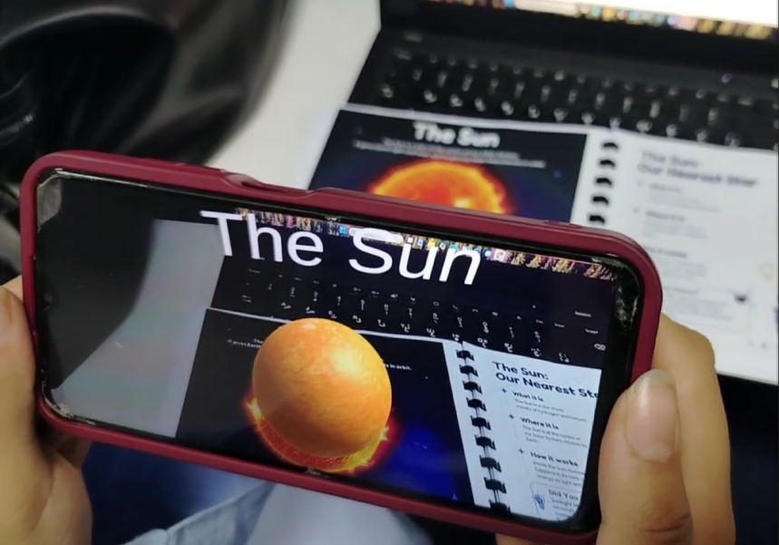

  

  

   

  <em>An Educational Augmented Reality Experience</em>

   

## ✨ About the Project

**Norya's Cosmic Journey** is an educational Augmented Reality (AR) experience designed to help users discover and explore space in an interactive and engaging way.

Guided by **Norya**, a friendly cosmic companion, users can explore celestial objects through an educational book and discover the universe using Augmented Reality.

This project was developed as part of the **Master's program in Immersive Technologies at ENSAM**.

## 🚀 Features

- **Image Recognition:** Detect book pages and display corresponding AR content.
- **3D Celestial Objects:** Explore planets and other objects in 3D.
- **Animations:** Discover animated elements and interactive scenes.
- **Textures and Materials:** Experience detailed visual representations of celestial objects.
- **Audio Narration:** Listen to explanations guided by Norya.
- **Educational Book:** Learn interesting facts about space through illustrated pages.
- **Video Content:** Discover additional space-related content.

## 🛠️ Technologies Used

- **Unity 6** – Application development.
- **Vuforia Engine** – Image tracking and Augmented Reality.
- **C#** – Interaction and animation scripting.
- **Blender** – 3D assets and visual content.

## 📖 Educational Book

The project includes an educational book designed to accompany the AR experience.

[📘 Read Norya's Cosmic Journey Book (PDF)](Documentation/Norya_Cosmic_Journey_Book.pdf)

## 🎬 Demo

A video demonstration of the application will be available here soon.

## 📱 Platform

- Android

## 🎓 Academic Project

Developed as part of the **Master in Immersive Technologies** at:

**École Nationale Supérieure d'Arts et Métiers (ENSAM)**  
Casablanca, Morocco

---

*Explore the universe, one page at a time!* ✨
